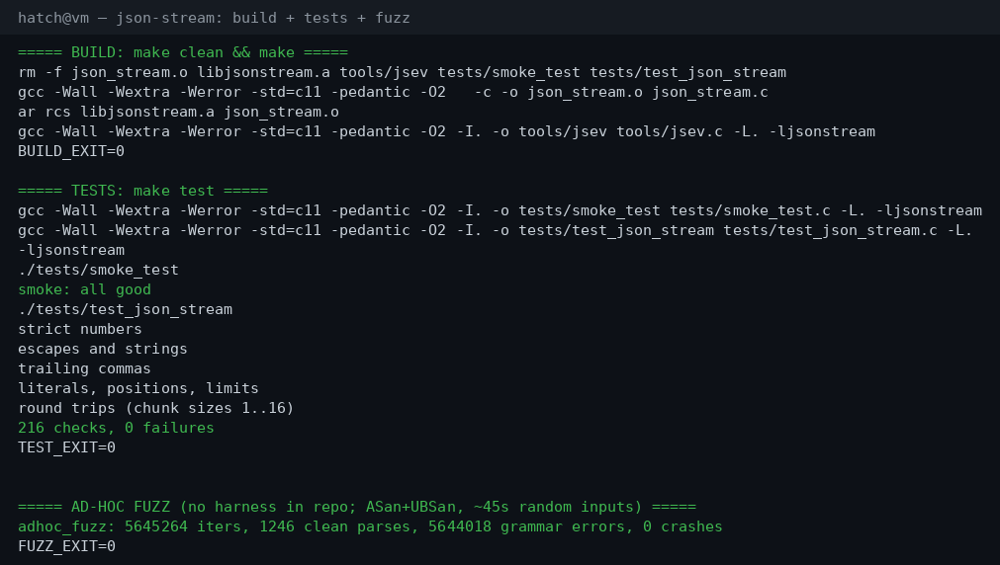
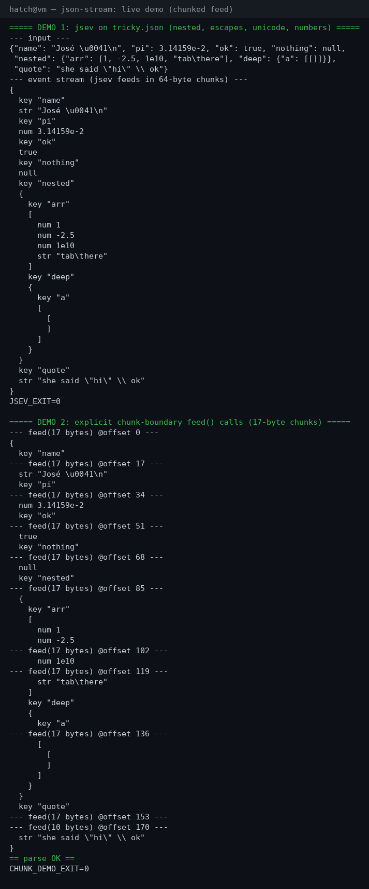

# json-stream

A SAX-style streaming JSON parser in C11. Feed it bytes in whatever chunks
you happen to have — off a socket, a file read loop, a UART DMA buffer —
and it calls you back with parse events as values complete. No malloc
anywhere: the parser is a caller-owned struct, and string/number payloads
point straight into your input buffer.

I wrote this for the config-file-shaped problem: small JSON blobs arriving
over transports that don't respect token boundaries. DOM parsers want the
whole document; this one doesn't.

## Quick start

```c
#include "json_stream.h"
#include <stdio.h>

static void on_event(const json_event_t *ev, void *user) {
    (void)user;
    if (ev->type == JSON_EV_KEY)
        printf("key: %.*s\n", (int)ev->len, ev->str);
    if (ev->type == JSON_EV_NUMBER)
        printf("num: %.*s\n", (int)ev->len, ev->str);
}

int main(void) {
    json_parser_t p;
    json_err_t err;

    json_parser_init(&p, on_event, NULL);

    /* chunks can split anywhere — mid-string, mid-number, mid-literal */
    err = json_feed(&p, "{\"temp\": 23", 11);
    if (err != JSON_OK) { /* ... */ }
    err = json_feed(&p, ".5, \"ok\": true}", 14);
    if (err != JSON_OK) { /* ... */ }
    err = json_finish(&p);   /* signal end of input */
    return err != JSON_OK;
}
```

Build and test:

```sh
make          # libjsonstream.a + the jsev tool
make test     # smoke test + full suite (216 checks)
```

There's also a little devtool, `tools/jsev`, which prints the event
stream of a document — handy for eyeballing what the parser sees:

```sh
./tools/jsev '{"a": [1, 2, {"b": null}]}'
```

## How it works

**Events, not a tree.** As each value completes, you get one callback:
object/array start/end, key, string, number, true, false, null. Strings
and numbers arrive raw — escapes are *not* decoded, numbers are *not*
converted. That keeps the parser small and leaves policy (how you want
`\u0041` handled) to you.

**Borrowed pointers.** In the common case the event's `str`/`len` point
directly into the chunk you just fed in. The wrinkle: if a token straddles
a chunk boundary it gets assembled in a small fixed scratch buffer inside
the parser, and the event points there instead. Either way, treat the
pointer as borrowed — it's only good until the next event fires, so copy
out anything you keep.

**Strict grammar.** This parser rejects what the JSON spec rejects:
trailing commas (`[1,]`), leading zeros (`01`), `NaN`/`Infinity`,
single quotes, comments, trailing garbage after the root value. If you're
parsing config files written by humans, strictness is a feature — a typo
should fail loudly at line 12, not silently become something else.

**Sticky errors.** Once `json_feed`/`json_finish` reports an error, the
parser keeps reporting it until you re-init. The failure position is kept
for diagnostics:

```c
unsigned line, col;
json_parser_where(&p, &line, &col);
printf("parse failed at %u:%u: %s\n", line, col, json_err_str(err));
```

## Error codes

| Code | Meaning |
|---|---|
| `JSON_ERR_DEPTH` | nesting deeper than 64 levels |
| `JSON_ERR_UNEXPECTED_CHAR` | a byte that fits nowhere in the grammar |
| `JSON_ERR_UNEXPECTED_EOF` | input ended mid-value or mid-container |
| `JSON_ERR_TOKEN_TOO_LONG` | a single token bigger than the scratch buffer |
| `JSON_ERR_BAD_LITERAL` | `truz` and friends |
| `JSON_ERR_TRAILING_DATA` | non-whitespace after the root value |
| `JSON_ERR_BAD_NUMBER` | a number that breaks the JSON grammar |
| `JSON_ERR_TRAILING_COMMA` | `[1,]` and friends |

## Limits (the honest list)

- **Nesting:** 64 levels max (`JSON_STREAM_MAX_DEPTH`). The 65th opener
  is `JSON_ERR_DEPTH`. Plenty for config; this is not a GeoJSON parser.
- **Scratch:** 1024 bytes (`JSON_STREAM_SCRATCH`). A token that fits in
  one chunk never touches it; a token split across chunks gets spilled
  there, and a token longer than 1024 bytes is `JSON_ERR_TOKEN_TOO_LONG`.
  Long strings are fine as long as they arrive in one piece — the limit
  only binds chunk-split tokens.
- **Columns count bytes, not characters.** Multi-byte UTF-8 advances the
  column by its byte length. UTF-8 content itself passes through
  untouched (it's just string payload).
- **No `\u` decoding.** `\u0041` arrives as the six raw characters
  `\u0041`. Decoding is caller policy.
- **Caller bugs, not checked:** passing a NULL parser, or NULL `data`
  with `len > 0`, is undefined behavior — same deal as `memcpy`. A NULL
  callback is fine (events are silently dropped); `json_feed(p, NULL, 0)`
  is a no-op.

## Layout

- `json_stream.h` / `json_stream.c` — the parser. One struct, two entry
  points (`json_feed`, `json_finish`), no dependencies beyond libc headers.
- `tools/jsev.c` — event-stream printer (builds to `tools/jsev`).
- `tests/test_json_stream.c` — the full suite: strict-grammar cases,
  escapes, literal edge cases, depth/scratch limits, and round trips at
  every chunk size from 1 to 16 bytes.
- `tests/smoke_test.c` — a small sanity check over chunked input.

## Screenshots


*`make test` — the full suite, 216 checks, zero failures.*


*`jsev` printing the event stream of a tricky document (escapes, `\u0041`, floats with exponents), fed in 17-byte chunks so tokens reassemble across `feed()` boundaries.*

## License

MIT — see [LICENSE](LICENSE).
